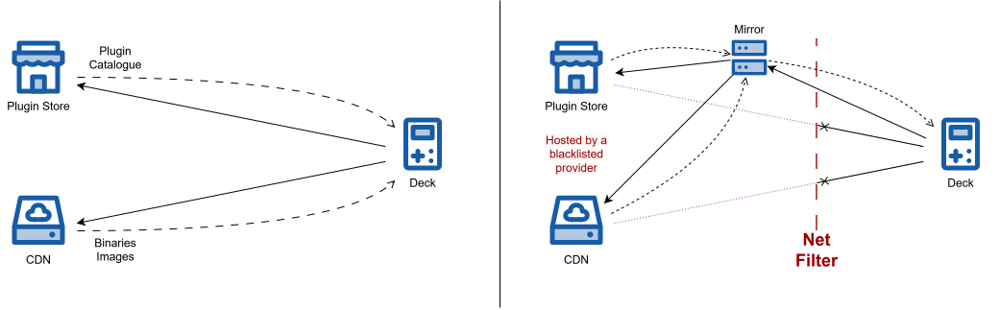

# Decky Store Proxy

A simple proxy for the Decky Plugin Store catalogue and resources.


## API structure

`GET /` serves a small information page with the version and links to the
repository, API documentation, and plugin catalogue.

Interactive API documentation: http://127.0.0.1:8000/docs
OpenAPI schema: http://127.0.0.1:8000/openapi.json

Catalogue CORS allows `https://steamloopback.host`, `GET`, and the
`X-Decky-Version` header. Preflight requests are handled by the CORS middleware.

### Store API

Proxies the Decky Store API at `TARGET_STORE_DOMAIN`:

- `GET /plugins` — relay the catalogue and substitute resource URLs.
- `POST /plugins/{plugin_name}/versions/{version_name}/increment` — relay installation statistics.

See the [API of the official store](docs/DECKY_STORE_API.md) and the
[API consumed by the Decky client](docs/DECKY_CLIENT_API.md).
The proxy's response always contains an `artifact` string:

| Upstream value                       | Proxy URL                                                      |
|--------------------------------------|----------------------------------------------------------------|
| `artifact` missing or `null`         | `https://${DOMAIN}/resources/hash/${version.hash}`             |
| `artifact` contains an explicit URL  | `https://${DOMAIN}/resources/base64/${base64url}.${signature}` |
| `image_url` contains an explicit URL | `https://${DOMAIN}/resources/base64/${base64url}.${signature}` |

### Resources API

- `GET /resources/hash/{hash}` — retrieve `https://${TARGET_CDN_DOMAIN}/file/steam-deck-homebrew/versions/${hash}.zip`.
- `GET /resources/base64/{base64url}.{signature}` — verify the signature, decode the complete original URL and relay that resource.

Catalogue links carry a 22-character signature (HMAC-SHA256 truncated to 16 bytes).
Unsigned links and invalid signatures return `403` without contacting upstream.
Links have no expiry; changing the signing key invalidates previously issued links.
This feature prevents the service from being used as an arbitrary-destination proxy.

Upstream HTTP statuses and relevant response headers are relayed. Failures after
resource streaming begins terminate the stream; the upstream response is closed.

## Install and run

**Prerequisites**:
- uv
- Python 3.14.8 (uv can install the pinned interpreter automatically)

```sh
uv sync --locked
uv run uvicorn decky_proxy.main:app --host 127.0.0.1 --port 8000
```

To run the tests:
```sh
uv run python -m unittest discover -s tests -t .
```

## Environment variables

All four variables are required. The Python application loads `.env` from the project directory; existing environment variables take precedence. The three domain values are hostnames without a scheme or path.

| Variable               | Example                | Purpose                                                |
|------------------------|------------------------|--------------------------------------------------------|
| `DOMAIN`               | `decky.example.com`    | Public proxy domain                                    |
| `TARGET_STORE_DOMAIN`  | `plugins.deckbrew.xyz` | Upstream Decky store domain                            |
| `TARGET_CDN_DOMAIN`    | `cdn.tzatzikiweeb.moe` | Upstream CDN domain                                    |
| `RESOURCE_SIGNING_KEY` | `random`               | Resource link signing secret or random key per process |

Example `.env`:
```dotenv
DOMAIN=decky.example.com
TARGET_STORE_DOMAIN=plugins.deckbrew.xyz
TARGET_CDN_DOMAIN=cdn.tzatzikiweeb.moe
RESOURCE_SIGNING_KEY=random
```

Set `RESOURCE_SIGNING_KEY=random` to generate a new key once per process start;
previous links stop working after a restart and clients must refresh the catalogue.
Any other nonempty value is used verbatim as a persistent UTF-8 secret, keeping
links valid across restarts while that key remains unchanged.

## Setup as systemd service behind Caddy

Run Uvicorn on `127.0.0.1:8000` and use Caddy as the public HTTPS entry point.
For a systemd service, use the following entries in its `[Service]` section,
replacing `/opt/decky-proxy` with the project directory:

```ini
WorkingDirectory=/opt/decky-proxy
ExecStart=/opt/decky-proxy/.venv/bin/uvicorn decky_proxy.main:app --host 127.0.0.1 --port 8000 --proxy-headers --forwarded-allow-ips 127.0.0.0/8,::1/128
```

Save the following configuration as `Caddyfile`:

```caddyfile
YOUR_DOMAIN {
    reverse_proxy 127.0.0.1:8000
}
```

With `DOMAIN` set in its environment, start Caddy:

```sh
caddy run --config ./Caddyfile --adapter caddyfile
```

See [Caddy environment variables](https://caddyserver.com/docs/caddyfile/concepts#environment-variables)
and [automatic HTTPS](https://caddyserver.com/docs/automatic-https).

## License

Project code is licensed under the [MIT License](LICENSE).

IconPark icons used in the diagrams are licensed separately under
[Apache-2.0](docs/diagrams/icons/LICENSE-IconPark.txt).

